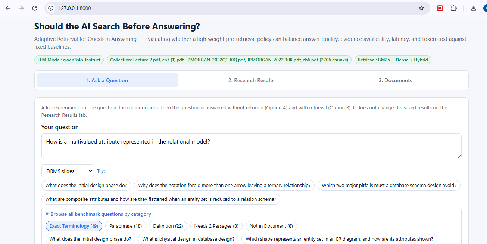
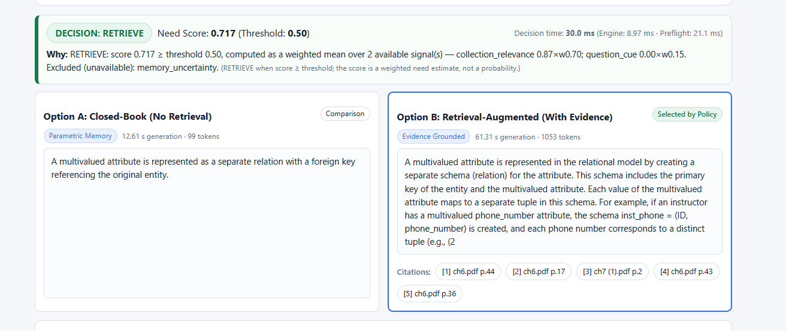
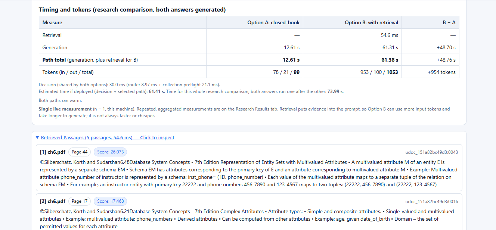
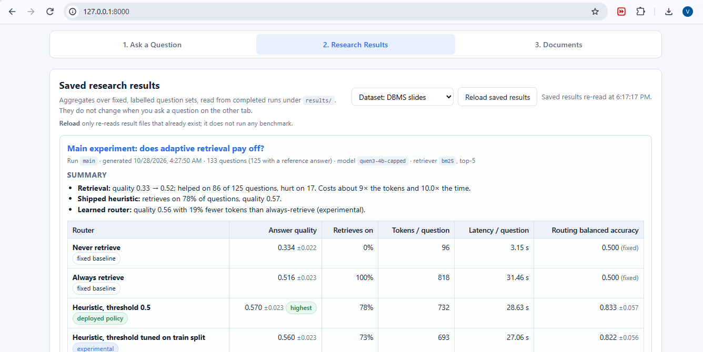
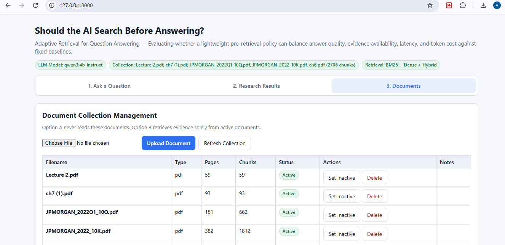

# Should the AI Search Before Answering? Adaptive Retrieval Decision Engine

A QA research project that tests one question: **can a lightweight pre-retrieval
decision engine predict when retrieval will help, and does deciding adaptively
beat "always retrieve" or "never retrieve" on quality, latency and cost?**

It includes:

- three retrievers: **BM25**, **dense** (`all-MiniLM-L6-v2`) and **hybrid** (Reciprocal Rank Fusion)
- two answering paths: closed-book (Option A) and grounded on retrieved chunks (Option B)
- a **decision engine** (heuristic + learned scikit-learn classifier) that picks a path from the question alone
- evaluation scripts for retrieval quality, routing, latency and downstream answer quality
- a FastAPI + single-page **dashboard** to ask questions, view saved results and manage documents

## Screenshots

**Ask a question**: the router decides, then both answers are shown.



**Decision and answers** (Option A closed-book vs Option B with retrieved evidence and citations):



**Timing, tokens and retrieved passages** for the same question:



**Research results**: saved routing experiment comparing the policies.



**Documents**: upload and manage the collection.



## Setup

Requires Python 3.10+.

```powershell
python -m venv .venv
.\.venv\Scripts\Activate.ps1
pip install -r requirements.txt
copy .env.example .env
```

On Linux/macOS: `source .venv/bin/activate` and `cp .env.example .env`.

`sentence-transformers` (in `requirements.txt`) pulls PyTorch, about 2.5 GB. It is only needed for the
`dense` and `hybrid` retrievers. BM25 works without it.

### Configure the LLM

The dashboard and the downstream/routing evaluations call any OpenAI-compatible endpoint. Edit `.env`:

```ini
# Local, using Ollama (ollama pull qwen3:4b-instruct)
LLM_API_KEY=ollama
LLM_BASE_URL=http://localhost:11434/v1
LLM_MODEL=qwen3:4b-instruct
```

Pin a concrete model id. Routing aliases such as `openrouter/free` change the backend model on every
call, which makes results non-reproducible and can return non-answers.

## Run the dashboard

```powershell
.\.venv\Scripts\python.exe -m uvicorn api.main:app --port 8000
```

Open http://127.0.0.1:8000. Make sure the LLM from `.env` is running (for example `ollama serve`).

1. **Documents**: upload PDF, TXT, MD or DOCX files. They are chunked and indexed, and can be toggled active or deleted.
2. **Ask a Question**: the decision engine runs first, then
   - `compare` mode runs both Option A (closed-book) and Option B (retrieved evidence) side by side;
   - `adaptive` mode runs only the chosen path.

   You can pick BM25, Dense or Hybrid for Option B.
3. **Research Results**: saved aggregates read from `results/`. Reloading only re-reads files and runs nothing.

The first LLM call after startup includes model load time and is flagged as a cold start.

## Run the experiments

All scripts are in `scripts/` and write to `results/` or `runs/`.

```powershell
# Retrieval quality: BM25 vs dense vs hybrid (no API key needed)
python scripts\eval_retrieval.py --methods bm25,dense,hybrid --top-k 10 --repeat 3

# Routing: does the router retrieve exactly when retrieval helps? (needs LLM; resumable)
python scripts\eval_routing.py
python scripts\eval_routing.py --no-llm        # re-analyse cached answers only

# Downstream QA: closed-book vs bm25/dense/hybrid (needs LLM)
python scripts\eval_downstream.py --limit 6 --top-k 5

# Four-policy decision experiment on HotpotQA
python scripts\build_dataset.py --force
python scripts\train_decision.py --config configs\default.json
python scripts\run_experiment.py --config configs\default.json --limit 60

# Latency benchmark, with interleaved A/B order and cold start reported separately
python scripts\bench_latency.py --trials 3

# Policy decision metrics (confusion matrix) and tests
python scripts\eval_policy.py
python -m pytest tests -q
```

Tests need no network or API credits. The LLM calls and the embedder are mocked.

## How it works

```
question ──► decision engine (sees only the question)
                  │
        RETRIEVE / DO_NOT_RETRIEVE
          │                    │
   Option A: closed-book   Option B: retrieve (bm25 | dense | hybrid) → grounded answer
```

- **Adaptive mode** runs only the selected path. **Cross-verify mode** runs both paths for offline evaluation.
- The decision engine never sees reference answers, labels or retrieved passages. `tests/test_leakage.py` enforces this.
- Policies compared: `never_retrieve`, `always_retrieve`, `adaptive`, and an offline `oracle` (upper bound, never used live).
- Splits are question-level. The classifier trains on train rows only and the threshold is tuned on validation only.
- Timings use a monotonic clock and are stored per stage (decision, retrieval, generation).

### Retrieval methods

| Method | Description | File |
|---|---|---|
| `bm25` | Okapi BM25, in-repo, no dependency | `adaptive_qa/retrieval/bm25.py` |
| `dense` | cosine similarity over MiniLM embeddings, cached in `data/embeddings/` | `adaptive_qa/retrieval/dense.py` |
| `hybrid` | RRF of both rankings, `Σ 1/(60 + rank)` | `adaptive_qa/retrieval/hybrid.py` |

If `sentence-transformers` is missing, dense and hybrid raise an error. There is deliberately no silent
fallback to BM25.

### Project layout

| Path | Role |
|---|---|
| `adaptive_qa/decision/` | heuristic and learned decision engines, features |
| `adaptive_qa/retrieval/` | BM25, dense, hybrid retrievers |
| `adaptive_qa/answering/` | closed-book engine, grounded reader, LLM backend, answer cache |
| `adaptive_qa/eval/` | metrics, outcome labels, policy and routing evaluation, charts |
| `adaptive_qa/documents.py` | upload, extraction, chunking, document store |
| `api/main.py` | FastAPI backend |
| `dashboard/index.html` | single-page dashboard |
| `eval_data/` | labelled question sets |
| `configs/default.json` | experiment configuration |

## Results (retrieval, Chapter 6 corpus)

80 chunks, 75 questions (67 scored), `--top-k 10 --repeat 3`, CPU.

| Method | Recall@5 | MRR@10 | nDCG@10 | hit@1 | median query |
|---|---|---|---|---|---|
| bm25 | 0.918 | 0.733 | 0.787 | 0.582 | 0.12 ms |
| dense | 0.925 | 0.718 | 0.770 | 0.597 | 28.3 ms |
| hybrid | **0.948** | **0.811** | **0.846** | **0.731** | 18.8 ms |

Hybrid is best on all ranking metrics here. This is one small corpus, so the numbers are descriptive, not significant.
Metric definitions and the labelling protocol are in [eval_data/retrieval_eval/README.md](eval_data/retrieval_eval/README.md).
Full outputs are in `results/`.

## Limitations

- The HotpotQA closed-book "LLM" is a deterministic extraction engine over a simulated memory, not a neural model.
  The experimental design transfers, the absolute quality numbers do not.
- Answer quality uses token-F1, which is blind to paraphrase.
- The downstream QA run is a small smoke test. Re-run with a pinned model and all questions for reportable numbers.
- Dense and hybrid always return k passages, so they cannot signal "nothing found".
- The routing workload mixes corpus and general questions by construction, so savings describe that mix, not real traffic.
